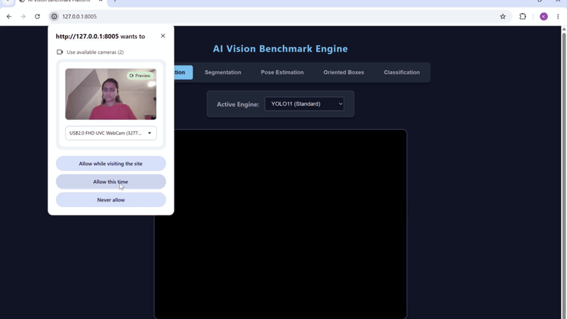

# AI Vision Benchmark Engine

A high-performance, real-time computer vision platform designed for enterprise edge environments. Built strictly with open-source, local libraries, it has **zero external cloud dependencies** and prioritizes fast local execution.

## Overview & Core Objectives

The platform streams live webcam feeds and supports **zero-latency model hot-swapping** across multiple specialized computer vision tasks, running natively on the GPU.

- **Stable long-running streams:** the pipeline uses the `stream=True` generator to prevent RAM bloat over prolonged streaming sessions.
- **Clean separation of concerns:** video handling (capture and rendering loops via WebSockets) is fully decoupled from the core model prediction logic, giving a modular and scalable backend.
- **Fully local:** all model weights are stored on disk and loaded locally.

## System Architecture (Domain-Driven Design)

The backend follows a Domain-Driven Design (DDD) layout to keep the repository scannable and aligned with industry-standard Python conventions. Routing uses a **two-tier Factory Pattern**:

1. **`VisionManager` (the Router):** a high-level controller that caches instantiated models in GPU VRAM and routes WebSocket JSON payloads to the appropriate engine.
2. **Isolated Task Engines:** individual modules (`detection.py`, `segmentation.py`, `pose.py`, etc.) inherit from a strict `BaseVisionEngine` abstract class. This guarantees standardized JSON outputs regardless of the underlying ML framework (Ultralytics YOLO vs. Hugging Face Transformers).

## Supported Tasks & Models

The frontend uses a dynamic two-tier interface. Selecting a task automatically re-routes the canvas logic to draw the appropriate overlays (boxes, polygons, skeletal lines) and updates the available model registry.

| Task Type | Render Output | Supported Models | Characteristics |
|---|---|---|---|
| Object Detection | Bounding Boxes | YOLO11n, RT-DETR, YOLO-World, OWLv2 | Standard 80-class detection plus zero-shot, open-vocabulary text prompts |
| Segmentation | Polygon Masks | YOLO11n-Seg | Traces exact pixel-level contours of detected objects |
| Pose Estimation | Skeletal Keypoints | YOLO11n-Pose | Maps 17 standardized human joints and connecting lines |
| Oriented Boxes | Rotated Polygons | YOLO11n-OBB | Detects objects at various angles for tighter bounding |
| Classification | Global Text Overlay | YOLO11n-Cls | Evaluates the entire frame and outputs a single categorical label |

<p align="center">
  
</p>

## Installation & Setup

### Prerequisites

- Python 3.10+
- A CUDA-capable GPU (recommended)
- A webcam

### 1. Clone the Repository & Install Dependencies

```bash
git clone https://github.com/khushbu4745/live-video-detection-engine.git
cd live-video-detection-engine
python -m venv .venv
source .venv/bin/activate  # On Windows: .venv\Scripts\activate
pip install -r requirements.txt
```

### 2. Download Local Weights

To adhere to the offline execution constraint, all model weights must be downloaded to the `models/` directory **before** running the server:

```bash
mkdir models
curl -L -o models/yolo11n.pt https://github.com/ultralytics/assets/releases/download/v8.3.0/yolo11n.pt
curl -L -o models/yolo11n-seg.pt https://github.com/ultralytics/assets/releases/download/v8.3.0/yolo11n-seg.pt
curl -L -o models/yolo11n-pose.pt https://github.com/ultralytics/assets/releases/download/v8.3.0/yolo11n-pose.pt
curl -L -o models/yolo11n-obb.pt https://github.com/ultralytics/assets/releases/download/v8.3.0/yolo11n-obb.pt
curl -L -o models/yolo11n-cls.pt https://github.com/ultralytics/assets/releases/download/v8.3.0/yolo11n-cls.pt
curl -L -o models/rtdetr-l.pt https://github.com/ultralytics/assets/releases/download/v8.3.0/rtdetr-l.pt
```

> **Note:** OWLv2 must be downloaded separately from Hugging Face and saved to your shared models directory. Update `src/engines/detection.py` with your specific local path.

### 3. Launch the Edge Server

Start the FastAPI WebSocket server:

```bash
uvicorn app:app --host 0.0.0.0 --port 8005
```

Then open [http://localhost:8005](http://localhost:8005) in your browser, grant camera permissions, and start exploring the benchmark platform.
